# Рекомендации без ручных признаков
## Задача
Смысл задачи в том, чтобы с помощью глубокого обучения избавиться от ручных признаков. Нужно одно условное распределение: вероятность того, что пользователь посмотрит товар в момент времени, при всём, что было до него.

Для начала вообще задаться вопросом: а почему глубокие модели в принципе не способны какие-то вещи учить или воспринимать? Почему мы до сих пор пользуемся моделями машинного обучения с ручными признаками? Поэтому в этом документе я провёл увесистый обзор методов, проверил бейзлайны и современные продвинутые решения, и предложил свою модификацию.
## Данные и бейзлайны
Первый датасет – лог просмотров онлайн-кинотеатра KION [Petrov et al., 2022](https://arxiv.org/abs/2209.00325). В нём таблица событий и две таблицы атрибутов пользователей и фильмов. История здесь короткая: у половины пользователей не больше двух событий, а у большой части тестовых пользователей до окна нет ни одного досмотра. Время записано с точностью до дня, так что порядка событий внутри дня нет. Показов в логе тоже нет, поэтому негатив – это пара пользователь–фильм, про которую в окне ничего не произошло. Таргетом взял досмотр хотя бы на 10%.

Второй датасет – Yambda от Яндекс Музыки [Ploshkin et al., 2025](https://arxiv.org/abs/2505.22238). Здесь всё наоборот: истории длинные, время записано с точностью до секунд, а в каталоге почти миллион треков. Каталог такого размера не помещается в память ни EASE, ни входу нейросети, поэтому я оставил 20 тысяч треков с самым большим числом слушателей и тысячу пользователей с самой длинной историей. Отдельно пришлось решить, что считать таргетом. Как и в статье Yambda, таргет сделал по двум меткам: прослушивание хотя бы половины трека и лайк.

На обоих датасетах я делю конец лога на три окна по 14 дней. На первом окне модель учится, на втором я выбираю число деревьев или эпоху, на третьем один раз считаю тест. Признаки и историю для каждого окна беру только из событий до его начала, так что утечки из будущего нет. Кандидаты – 300 самых популярных "товаров" до начала окна, одни и те же для всех моделей.

Смотрел на 3 главные метрики:
- **NDCG@10** смотрит, насколько высоко в десятке лучших стоят фильмы, которые человек реально посмотрел. Это главная метрика, потому что рекомендации пользователь видит списком.
- **Recall@10** смотрит, какую долю досмотренного десятка вообще поймала.
- **ROC AUC** сравнивает все пары сразу. Поэтому он чувствителен к тому, сопоставимы ли скоры между разными пользователями, а не только к порядку внутри одного пользователя.

Первый бейзлайн – популярность. Каждому пользователю она выдаёт один и тот же список: фильмы, у которых до окна больше всего разных досмотревших. Это нижняя граница, но на KION она сильная, потому что у многих пользователей истории нет совсем, и предложить им что-то лучше популярного нечем.

Второй бейзлайн – EASE [Steck, 2019](https://arxiv.org/abs/1905.03375), линейный автоэнкодер над матрицей «пользователь на товар». В замкнутой форме он выучивает матрицу «товар на товар» с нулевой диагональю, и скор кандидата равен сумме весов от товаров, которые пользователь уже посмотрел. Признаков и атрибутов у него нет. Я взял его, потому что это самый простой метод, который учит парное распределение товаров, и по нему видно, сколько информации это распределение даёт само по себе.

Третий бейзлайн – CatBoost на ручных признаках, стандартная сильная модель для табличных данных. Добавил базовые ручные признаки – атрибуты пользователя и фильма плюс счётчики за 7 дней, 30 дней и всё время: число событий и досмотров, средний процент досмотра, число разных товаров или пользователей и давность последнего события. Эти счётчики я считаю отдельно для пользователя, для фильма по всем пользователям и для пары. К ним я добавил скоры EASE и косинусного kNN по товарам, и попробовал именно ранжирующий лосс YetiRank.

Чтобы понять, откуда у бустинга качество, я обучил его ещё в двух вариантах. В первом нет скоров EASE и kNN. Во втором вместо ручных признаков стоит автоматически сгенерированный набор: перебор агрегатов «сущность × событие × окно × агрегат», 489 колонок. По нему видно, можно ли заменить ручную работу перебором.

Потом я попробовал нейросети. Первая – авторегрессионный трансформер над последними событиями пользователя, как SASRec: кроме метки окна он учится предсказывать следующий фильм в истории. Скор у него – вектор пользователя, умноженный на эмбеддинг фильма, плюс обучаемое число на каждый фильм. Вторая – TabM [Gorishniy et al., 2025](https://arxiv.org/abs/2410.24210), ансамбль MLP для таблиц, на тех же строках и признаках, что и бустинг. Трансформер проиграл даже популярности, а на валидации он лучше всего на второй эпохе и дальше переобучается (рис. 1, 2). Отсюда вопрос, почему так вышло.
## Почему глубокие модели проигрывают ручным признакам
### Нужных данных нет в строке
Первую часть ответа дал трансформер, который видит только историю самого пользователя: он упал ниже популярности (рис. 1). Перемешивание колонок бустинга показывает то же самое: почти вся польза сидит в счётчиках фильма по всем пользователям, особенно за последнюю неделю (рис. 4).

По итогу первая причина в том, что нужных данных нет в строке. «Сколько раз пользователь покупал фрукты за 7 дней до момента предсказания» – это свойство не строки, а всей таблицы до этого момента. Счётчик точно считает все события пользователя, включая те, что как строки в обучающую выборку не попадают. Если нейросеть тоже видит историю, как последовательные модели [Zhai et al., 2024](https://arxiv.org/abs/2402.17152), такие вещи она действительно учит. Но популярность товара за последний час – это сумма по всем пользователям, и из истории одного пользователя её не получить никакой моделью.

По сути, глубокие модели не могут получить контекст, который дают ручные признаки, и линейные модели тоже не могут. Чтобы посчитать агрегат вроде суммы какой-либо фичи по всем айтемам, модели нужно держать в контексте все эти значения и сложить их какой-то выученной операцией. Держать в памяти весь датасет очень трудно, поэтому мы обходимся прокси-признаками: суммой, средним, медианой, квантилями и другими статистиками распределения.

И даже графовые нейросети не способны собрать многие зависимости: каждый узел агрегирует только своих ближайших соседей и ничего не знает о датасете целиком [Hamilton et al., 2017](https://arxiv.org/abs/1706.02216). Это тоже неточное представление.
### Выразительность
Вторая проблема – выразительность. Даже если подать сети нужные данные, остаётся вопрос, может ли она их выразить. Понятно, что в теории нейросеть может выразить всё что угодно, но по итогу какие-то классы функций выражаются очень трудно:
- **Сумма и количество.** Внимание пропускает веса событий через softmax, и после нормировки веса в сумме дают единицу. Поэтому выход внимания всегда взвешенное среднее: он выражает долю событий, но не их число, и пять одинаковых просмотров дают тот же выход, что один. Сумму возвращает внимание без нормировки, так делают в рекомендациях [Zhou et al., 2018](https://arxiv.org/abs/1706.06978). А вот в графовых сетях ставят рядом несколько свёрток, сумму, среднее и максимум [Corso et al., 2020](https://arxiv.org/abs/2004.05718).
- **Умножение.** MLP складывает взвешенные входы и пропускает их через нелинейность, поэтому произведение двух признаков он только приближает по кускам и плохо учит даже скалярное произведение эмбеддингов [Rendle et al., 2020](https://arxiv.org/abs/2005.09683). Поэтому умножение дают сети готовой операцией, как в кросс-слоях [Wang et al., 2020](https://arxiv.org/abs/2008.13535).
- **Деление.** Конверсия то деление. MLP приближает его только на тех значениях, которые видел в обучении, а за их пределами продолжает функцию непредсказуемо.
- **Агрегаты над множеством.** Сеть над множеством событий сворачивает их фиксированной функцией, обычно суммой или максимумом. Дисперсию или долю событий выше порога такая свёртка даёт только через дополнительные слои, поэтому агрегатор делают обучаемым, и его параметры выбирают, что он считает [Pellegrini et al., 2021](https://arxiv.org/abs/2012.08482).
- **Длинная цепочка операций.** Ручной признак – это фильтр, счёт, нелинейность и связь с кандидатом, четыре операции подряд. С промежуточным сигналом на каждом шаге такую цепочку сеть учит, а с одним сигналом в конце учит плохо [Shalev-Shwartz et al., 2017](https://arxiv.org/abs/1703.07950).

То есть проблема в основном в том, что градиентному спуску трудно найти нужную операцию. А некоторые операции архитектура в принципе выражает только при числе и ширине слоёв, стремящихся к бесконечности. Поэтому часть операций мы встраиваем в архитектуру готовыми, как пулинг в свёрточных сетях. Пулинг по окну событий считает сумму, среднее или максимум, то есть ровно те агрегаты, что лежат в ручных признаках, и учить эти операции градиентному спуску уже не нужно. Softmax так же даёт взвешенное среднее, а сеть поверх него ищет более сложные нелинейные зависимости.

Но для порога это уже сложнее. Если нейросеть учит порог сама, обучение идёт очень долго, а значения в некоторых слоях становятся нестабильными и слишком высокими. К тому же из-за спектрального байеса нейросети учат в основном гладкие функции [Rahaman et al., 2019](https://arxiv.org/abs/1806.08734). Интуитивно, проблема из-за того, что сдвинуть или заострить градиентом склон могут только точки на самом склоне, и чем уже склон, тем меньше на нём точек.

Агрегаты пулинг даёт готовыми, умножение даёт кросс-слой или гейт, а ступеньки среди стандартных элементов архитектуры нет, и градиентом она учится хуже всего. Поэтому step-функцию можно перенести из параметра во вход. В [Gorishniy et al., 2022](https://arxiv.org/abs/2203.05556) для этого использовали бакетирование: дерево находит границы корзин, а сеть учит вес при каждой корзине, и производная по этому весу никогда не бывает плоской. Таким образом предобработкой данных, автоматической или даже выученной, можно заставить нейросеть работать с такими данными. Если порог всё же нужен внутри сети, вперёд можно считать честную ступеньку, а назад делать вид, что её производная равна единице [Bengio et al., 2013](https://arxiv.org/abs/1308.3432).
### Почему не перебрать агрегаты
Тогда можно подумать, что пространство действий в задаче создания агрегаций не такое уж и большое. У нас есть дискретные, недифференцируемые операции, которые мы можем просто создавать вручную, и модели, нечувствительные к мусорным признакам и к мультиколлинеарности, чтобы всё это моделировать. Такие попытки тоже были: перебор агрегатов по связанным таблицам [Kanter and Veeramachaneni, 2015](https://doi.org/10.1109/DSAA.2015.7344858), отбор признаков по приросту на остатках бустинга [Zhang et al., 2023](https://arxiv.org/abs/2211.12507), а недавно такие же агрегаты стали подавать в табличные модели без обучения [Zhang et al., 2026](https://arxiv.org/abs/2602.18495), [Hayler et al., 2026](https://arxiv.org/abs/2608.16319). Я сделал такой перебор по комбинациям «сущность × событие × окно × агрегат», он дал 489 признаков. CatBoost на них на KION хуже, чем на 71 ручном признаке, а на Yambda такой же (рис. 1, 5, 6).

Но моделей, которые нечувствительны одновременно и к мусорным признакам, и к мультиколлинеарности, нет. Тем более если они нечувствительны к мусорным признакам, то это не глубокие модели, значит, они не могут учить распределения, которые нам нужны.

Если мы хотим совместить и то и то, можно сделать так, как сделали в ARGUS [Khrylchenko et al., 2025](https://arxiv.org/abs/2507.15994): скор глубокой модели идёт признаком в бустинг. Если же мы хотим единое решение, то графовые нейросети тоже не особо подходят. Они создают эмбеддинги, которые смотрят на своих соседей, и не пропагируют значение настолько далеко и настолько эффективно, как хотелось бы. Поэтому после перебора я перестал отбирать признаки и перешёл к архитектуре, которая учит их сама.
## Предобработка
При этом какая-то предобработка признаков всё равно нужна, поскольку признаки бывают и разных масштабов, и разных распределений, и нейросетям действительно трудно учить признаки с очень тяжёлыми хвостами. Поэтому базовую предобработку стоит делать, и стоит отделить её от остальной задачи: импутацию признаков, бакетирование, определение того, категориальный признак или непрерывный. Эти вещи зависят от того, что это за признак в принципе. Например, если это номер телефона, нужно смотреть на какие-то определённые его фичи, и модель, которая ничего не знает о мире, здесь ничего сделать не сможет. То есть это задача инженерная, и в целом она достаточно тривиальная, подбирать там ничего не нужно.

Делал базовую предобработку, по одному правилу на любую колонку:
- время → `Δt` до момента предсказания в логарифмических корзинах
- категории → id → эмбеддинг
- счётчики → `log(1 + n)`, остальные числа → квантили
- пропуск → отдельный бит.

Мы её оставляем и идём на уровень дальше. Мы хотим сделать структуру, которая выучивала бы все нужные взаимодействия между разными частями датасетов, состоящих из множества таблиц, и при этом была бы достаточно выразительной. На эту тему было несколько работ:
- **Модели над историей событий.** SASRec [Kang and McAuley, 2018](https://arxiv.org/abs/1808.09781) учит следующий товар через softmax-внимание, HSTU [Zhai et al., 2024](https://arxiv.org/abs/2402.17152) убирает нормировку внимания и добавляет поправку по времени, ARGUS [Khrylchenko et al., 2025](https://arxiv.org/abs/2507.15994) масштабирует такой трансформер и отдаёт его скор бустингу.
- **Графовые нейросети над базой.** RelBench [Robinson et al., 2024](https://arxiv.org/abs/2407.20060) строит графовую сеть по всем таблицам и связям между ними и учит её с нуля на каждую задачу. Для рекомендаций там же лучше всего работает сеть с пометкой узла-запроса, а сеть двух башен слаба [Yuan et al., 2024](https://arxiv.org/abs/2411.19513).
- **Реляционные модели с предобучением.** KumoRFM [Fey et al., 2025](https://kumo.ai/research/kumo_relational_foundation_model.pdf), Relational Transformer [Ranjan et al., 2025](https://arxiv.org/abs/2510.06377), RDB-PFN [Wang et al., 2026](https://arxiv.org/abs/2603.03805) и PluRel [Kothapalli et al., 2026](https://arxiv.org/abs/2602.04029) предобучаются на многих базах, в том числе синтетических, и отвечают по контексту.
- **Агенты.** Языковые модели неплохо придумывают идеи признаков, но плохо реализуют сложные [Zhang et al., 2024](https://arxiv.org/abs/2410.12865), а агент, который пишет SQL и проверяет его бустингом, обходит это циклом проб [Huang et al., 2026](https://arxiv.org/abs/2605.07840).

Агентные системы, даже если всё предобучить, смогут что-то найти и вытащить, но это всё равно большая инженерная работа, и она требует ещё понимания того, как ведёт себя реальный мир. Это всё равно что дать агенту что-либо сделать: нет никакой гарантии, что не будет ошибок. Интереснее сделать именно сложные нелинейные признаки, то есть не только автоматически выразить простые признаки и агрегаты, но и выразить нелинейные признаки, и всё одной моделью.
## Распределения на каждом уровне
Из этих моих этих наблюдений собралось решение: учить распределение на каждом из уровней. 
1. Сначала по каждой фиче, чтобы понять, как она себя ведёт и какой она формы. Всё это мы будем приводить в обычный неинтерпретируемый эмбеддинг, который со временем должен научиться представлять внутри себя и пороги, и всё остальное.
2. Помогаем мы ему разобраться с порогами и агрегатами тем, что ставим разные пулинги, выучиваемые гейты на бесполезные признаки и attention без нормировки. Так устроены лучшие табличные модели сейчас: TabICL [Qu et al., 2025](https://arxiv.org/abs/2502.05564) сначала смотрит на распределение каждой колонки, потом на признаки внутри строки, потом на строки, а TabPFN [Hollmann et al., 2025](https://doi.org/10.1038/s41586-024-08328-6) чередует внимание по признакам и по строкам. Поэтому решение построено на предобученном TabICL.

Для каждой пары «пользователь u, фильм p» модель получает маленькую таблицу из 65 строк. В ней 32 строки (u, f) с другими фильмами f и 32 строки (v, p) с другими пользователями v, у каждой метка «смотрел в прошлом окне». Последняя строка – сама пара, её метку модель и предсказывает. Колонки у всех строк это только биты «тот же пользователь», «тот же фильм», и т. д., `log(1 + n)` событий пользователя и фильма и атрибуты обоих.

Уровни такие:
1. **Каждый признак сам по себе.** Признак проходит через базовую предобработку и стандартизацию по строкам контекста. Дальше блок колонок TabICL смотрит на распределение колонки целиком и кодирует каждое значение с учётом его формы. У каждого признака есть гейт, одно обучаемое число от 0 до 1 со штрафом за число открытых гейтов [Yamada et al., 2020](https://arxiv.org/abs/1810.04247), так что мусорные признаки модель отключает сама.
2. **Между признаками одной строки.** Эмбеддинги признаков одной строки смотрят друг на друга через внимание, и строка собирает из них парные взаимодействия. Счётчики на входе стоят в логарифмах, а логарифмы превращают деление в вычитание.
3. **Между строками.** Строка пары смотрит на строки контекста, и вес каждой строки равен произведению вектора запроса строки пары на вектор ключа строки контекста. Биты совпадения стоят в самих строках, поэтому вес растёт у строк, похожих на пару. Свёрток две: softmax даёт долю, а `SiLU(·/√d)/n`, как в HSTU [Zhai et al., 2024](https://arxiv.org/abs/2402.17152), сохраняет количество. Бит совпадения, по сути, превращает жёсткий фильтр ручного счётчика в линейный вес без всякой ступеньки.
4. **Между таблицами и сущностями.** То, чего в истории пользователя нет, модель получает из 32 строк других пользователей этого фильма и из счётчика его событий до окна. На этот уровень указал бустинг: почти вся его польза сидит в статистике фильма по всем пользователям.

Дальше модель учит распределение уже между этими элементами. Attention и feedforward-слои по разным осям наших распределений, по признакам и по строкам, выучивают очень много признаков и распределений между элементами.
## Предобучение на синтетике
И самое главное, модели можно предобучать на синтетических данных, чтобы научить их работать с композитными задачами, где нужно неявно учить разные распределения и выражать разные операции. Action space всех операций не такой уж и большой, поэтому табличные значения можно создавать синтетически не очень сложными методами. Предобученные так модели получают нужные прайоры для дообучения под конкретную задачу или для работы с любыми табличными данными. На этом были построены TabPFN [Hollmann et al., 2025](https://doi.org/10.1038/s41586-024-08328-6), TabICL [Qu et al., 2025](https://arxiv.org/abs/2502.05564) и, для реляционных баз, PluRel [Kothapalli et al., 2026](https://arxiv.org/abs/2602.04029) и RDB-PFN [Wang et al., 2026](https://arxiv.org/abs/2603.03805). Я беру веса TabICL, которые авторы предобучили на синтетических таблицах.
## Результаты
Все модели я сравнивал на одних и тех же 200 тестовых пользователях, у каждого 300 кандидатов. TabICL считается долго, поэтому тест у него только на них, и остальные модели я считал на тех же, чтобы сравнение было честным.

### KION

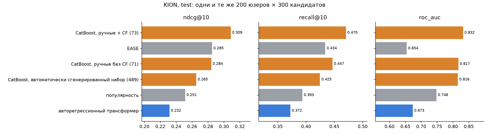

*Рис. 1. Метрики на тесте KION. Оранжевым бустинг, синим нейросети, серым популярность и EASE. В скобках число признаков.*

На KION лучше всех бустинг со скорами EASE и kNN. Без этих скоров он опускается до уровня самого EASE, так что коллаборативная фильтрация даёт ему заметную часть качества. Автоматически сгенерированный набор признаков хуже ручного. Трансформер над историей проиграл даже популярности.

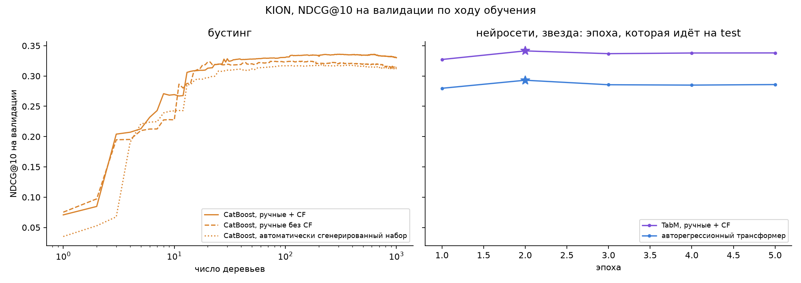

*Рис. 2. NDCG@10 на валидации по ходу обучения: слева по числу деревьев CatBoost, справа по эпохам нейросетей. Звездой отмечена эпоха, которая идёт на тест.*

Бустинг выходит на плато за несколько сотен деревьев. Трансформер лучше всего на второй эпохе, дальше валидация падает, и ранняя остановка его обрывает.

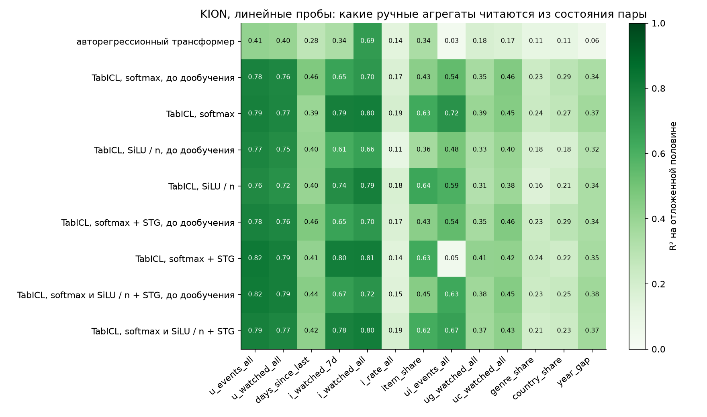

*Рис. 3. Линейные пробы на KION: R² ридж-регрессии из скрытого состояния пары в каждый ручной агрегат на отложенной половине пар.*

Чтобы посмотреть, что трансформер считает сам, я поставил линейные пробы: ридж-регрессию из скрытого состояния пары в каждый ручной агрегат. Лучше всего читается число досмотров фильма за всё время. Его сеть выучивает через эмбеддинг и смещение фильма, которые обучаются на метках всех пользователей. Счётчики пользователя читаются хуже. Число событий пары почти не читается, хотя это просто количество одного фильма в истории пользователя. Доли жанра и страны в истории, то есть деление одного счётчика на другой, тоже почти не читаются.

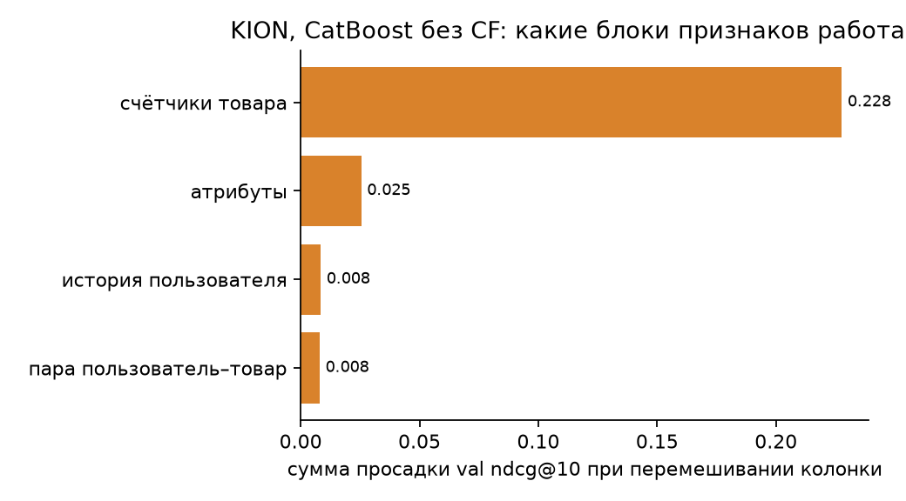

*Рис. 4. Просадка NDCG@10 на валидации, если перемешать одну колонку, просуммированная по блокам признаков. Модель CatBoost на ручных признаках без скоров EASE и kNN.*

Если перемешивать колонки бустинга, почти вся просадка приходится на счётчики фильма по всем пользователям, больше всего на досмотры и события за последнюю неделю. Атрибуты, история пользователя и пара дают мало.

### Yambda

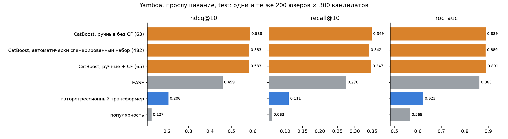

*Рис. 5. Метрики на тесте Yambda, таргет прослушивание хотя бы половины трека.*

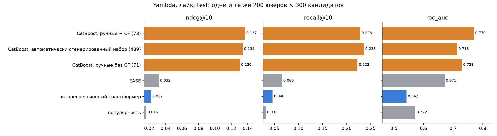

*Рис. 6. Метрики на тесте Yambda, таргет лайк.*

На Yambda разрыв ещё больше. На прослушиваниях все три варианта бустинга почти одинаковые и сильно впереди, за ними EASE, потом трансформер, и в самом конце популярность. Лайков на порядок меньше, чем прослушиваний, и там бустинг впереди уже в несколько раз, а EASE, трансформер и популярность почти неразличимы. Автоматически сгенерированный набор здесь работает так же, как ручной.

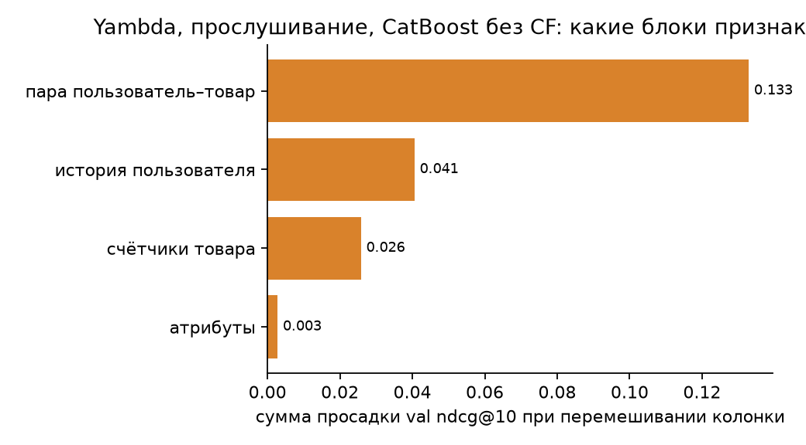

*Рис. 7. Важность блоков признаков на Yambda, прослушивание.*

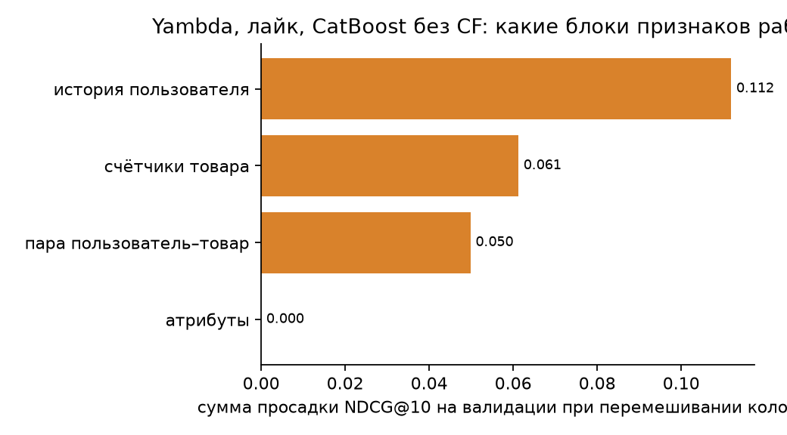

*Рис. 8. Важность блоков признаков на Yambda, лайк.*

А вот важность признаков на Yambda совсем другая. На прослушиваниях больше всего даёт пара пользователь–трек: люди переслушивают одни и те же треки, и счётчик прошлых прослушиваний пары предсказывает следующее. На лайках больше всего даёт история пользователя. То есть здесь всё нужное лежит в истории самого пользователя, а трансформер видит из неё последние 512 событий.

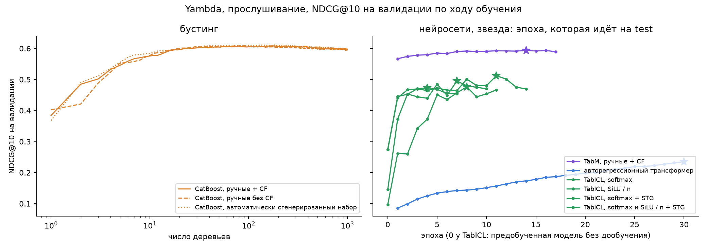

*Рис. 9. NDCG@10 на валидации Yambda, прослушивание.*

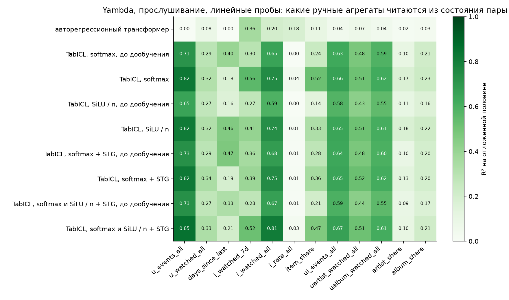

*Рис. 10. Линейные пробы на Yambda, прослушивание.*

И всё равно трансформер проигрывает бустингу в разы. По пробам число прослушиваний пары почти не читается из его состояния, хотя все эти прослушивания стоят у него на входе. Правда, на прослушиваниях трансформер не дошёл до плато, валидация росла до последней эпохи (рис. 9). Но к концу она прибавляла так мало, что до бустинга ему пришлось бы учиться ещё в несколько раз дольше.

### Размер моделей

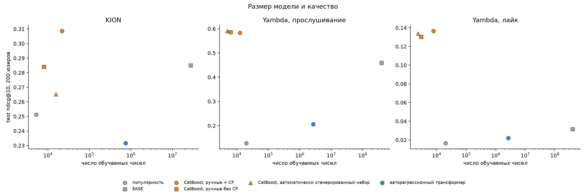

*Рис. 11. NDCG@10 на тесте против числа обучаемых чисел. У CatBoost это число деревьев, умноженное на 64 листа и 6 порогов, у EASE матрица «товар на товар», у популярности одно число на товар.*

Я посчитал, сколько обучаемых чисел у каждой модели. У CatBoost их меньше всех, кроме популярности, у трансформера на два порядка больше, а у EASE больше всех. Самая маленькая модель лучше всех на всех трёх задачах, так что дело не в размере.
## Итог
Ручные признаки выигрывают у глубоких моделей по двум причинам.

Первая – в строке и в истории пользователя нет нужных данных. На KION это видно напрямую: почти вся польза бустинга сидит в счётчиках фильма по всем пользователям, а трансформер над историей проигрывает даже популярности. Из статистики других пользователей он достаёт только популярность фильма, и то через смещение фильма, которое учится на метках всех пользователей.

Вторая – выразительность: пороги, количество, деление и длинные цепочки операций градиентный спуск находит плохо. На Yambda данные лежат в истории пользователя, трансформер их видит, но число повторов пары из них не собирает: softmax-внимание даёт среднее, и пять прослушиваний одного трека для него то же, что одно. Доли жанра, страны, артиста и альбома, то есть деление, не читаются из его состояния ни на одном датасете. И дело не в размере, у бустинга обучаемых чисел на порядки меньше.

Перебор агрегатов эти дыры не закрывает: на KION он ухудшил бустинг, на Yambda ничего не добавил. Поэтому решение должно подавать глобальную статистику отдельным входом, встраивать трудные операции в архитектуру готовыми, а пороги переносить во вход корзинами. В TabICL это строки других пользователей в контексте и свёртка `SiLU(·/√d)/n`, которая сохраняет количество.

Всё остальное, то есть распределения каждого признака, связи между признаками и между событиями, можно учить, и прайоры для этого можно получить предобучением на синтетике.

Спасибо за внимание, надеюсь на подробный фидбэк по работе.
