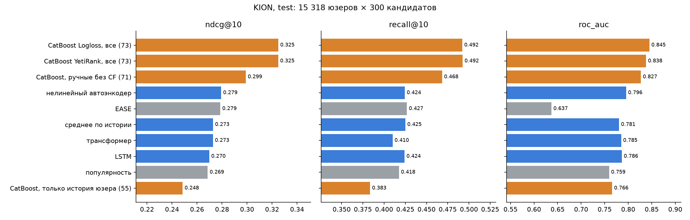
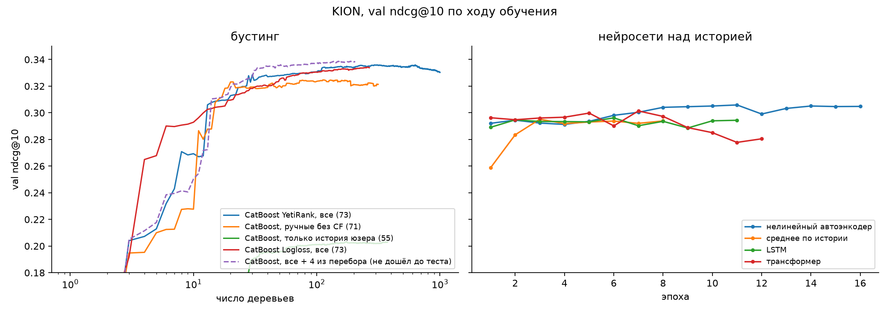
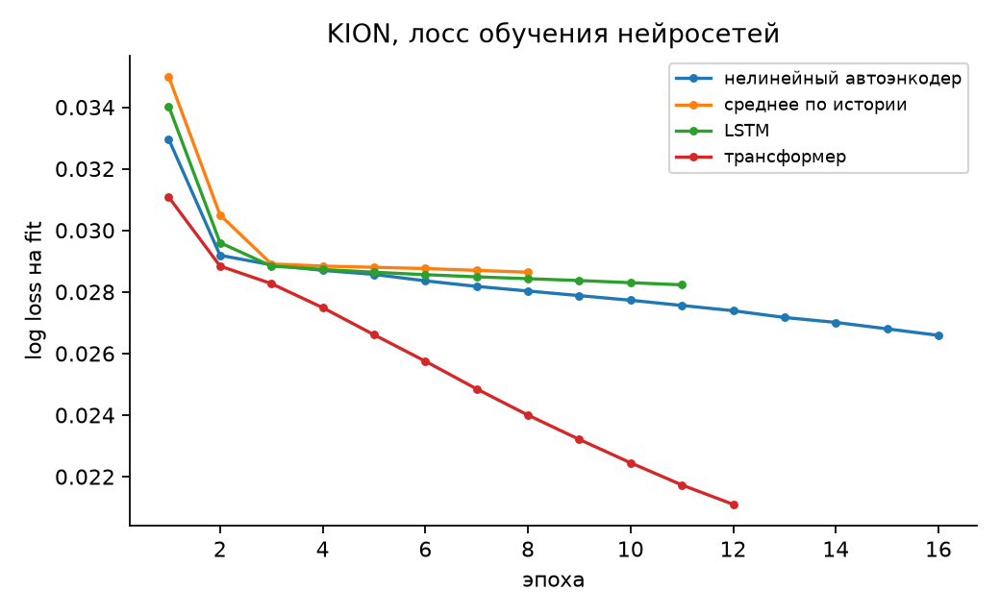
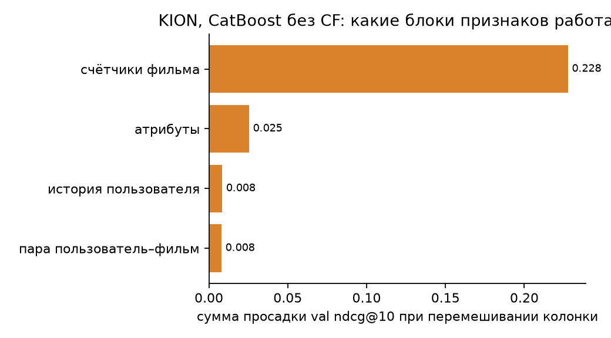

# Рекомендации без ручных признаков

## Задача

Смысл задачи в том, чтобы с помощью глубокого обучения избавиться от ручных признаков. Нужно одно условное распределение: вероятность того, что пользователь посмотрит товар в момент t, при всём, что было до t. Стоит вообще задаться вопросом: а почему глубокие модели в принципе не способны какие-то вещи учить или воспринимать? Почему мы до сих пор пользуемся моделями машинного обучения с ручными признаками? Я решил в этом разобраться.

Причём проблема не только в том, что мы не можем выразить агрегирующие признаки, а в том, что нам ещё нужно выразить признаки нелинейные. То есть возникают две проблемы, и решение должно закрывать обе.

## Почему глубокие модели проигрывают ручным признакам

### Нужных данных нет в строке

По итогу первая причина в том, что нужных данных нет в строке. «Сколько раз пользователь покупал фрукты за 7 дней до момента t» – это свойство не строки, а всей таблицы до момента t. Счётчик точно считает все события пользователя, включая те, что как строки в обучающую выборку не попадают. Если нейросеть тоже видит историю, как последовательные модели [Zhai и др., 2024], такие вещи она действительно учит. Но популярность товара за последний час – это сумма по всем пользователям, и из истории одного пользователя её не получить никакой моделью.

По сути, глубокие модели просто не могут получить тот контекст, который задаётся ручными признаками. Этого не могут и линейные модели. Агрегаты по типу суммы какой-либо фичи среди всех айтемов требуют как минимум того, чтобы в контексте были все эти значения и их можно было сложить какой-то выученной операцией. Но это очень трудно достижимо, поскольку в контексте, то есть в памяти, должно всё это находиться. Поэтому мы обходимся лишь прокси-признаками по типу суммы, среднего, медианы, квантилей, распределений и так далее.

И даже графовые нейросети не способны собрать очень многие зависимости, поскольку они работают относительно друг друга и могут сказать лишь о своих ближайших соседях, но не обо всём датасете [Hamilton и др., 2017]. Это тоже неточное представление.

### Выразительность

Вторая проблема – выразительность. Что вообще может выразить нейросеть? Понятно, что в теории она может выразить всё что угодно, но по итогу какие-то классы функций выражаются очень трудно:

- **Сумма и количество.** Выход внимания всегда взвешенное среднее по событиям, softmax считает долю, а не количество. Одного агрегатора мало, нужен набор [Corso и др., 2020], а в рекомендациях нормировку убирают совсем [Zhou и др., 2018].
- **Умножение.** Обычный MLP плохо учит даже скалярное произведение [Rendle и др., 2020], отсюда целое семейство кросс-архитектур [Wang и др., 2020].
- **Деление и разность.** Конверсию «клики на показы» нейросеть учит плохо и плохо продолжает за пределы обучающих значений.
- **Агрегаты над множеством.** Обычных `sum` и `max` бывает недостаточно, обучаемые агрегаторы приближают среднее, дисперсию и максимум отдельными параметрами [Pellegrini и др., 2021].
- **Длинная цепочка операций.** Ручной признак – это фильтр, счёт, нелинейность и связь с кандидатом. С промежуточным сигналом на каждом шаге такую цепочку сеть учит, с одним сигналом в конце учит плохо [Shalev-Shwartz и др., 2017].

То есть проблема в основном в том, что градиентному спуску трудно найти и выразить какую-то операцию. А иногда операция в принципе достижима архитектурой только при количестве и размерности слоёв, стремящихся к бесконечности. Поэтому мы используем некоторые операции в архитектуре, типа свёртки с пулингом. Пулинг позволяет нам делать step-функции и какие-то агрегаты. Для градиентного спуска это уже легко, поскольку эти операции не требуют обучения. Softmax так же может находить средние и искать более сложные нелинейные зависимости.

Но для таких задач, как порог, это уже сложнее. Если нейросеть будет учить порог сама, это будет очень долго и приведёт к нестабильным, слишком высоким значениям в некоторых слоях. Не говоря уже о том, что нейросети стремятся учить в основном гладкие функции из-за спектрального байеса [Rahaman и др., 2019]. Сдвинуть или заострить склон могут только точки на самом склоне, и чем уже склон, тем меньше на нём точек. Поэтому такие вещи в целом очень тяжелые, а step-функция – это очень важная часть моделирования.

Step-функцию можно перенести из параметра во вход. В [Gorishniy и др., 2022] для этого использовали бакетирование: дерево находит границы корзин, а сеть учит вес при каждой корзине, и производная по этому весу никогда не бывает плоской. Таким образом предобработкой данных, автоматической или даже выученной, можно заставить нейросеть работать с такими данными. Если порог всё же нужен внутри сети, вперёд можно считать честную ступеньку, а назад делать вид, что её производная равна единице [Bengio и др., 2013].

### Чем удобнее деревья

При этом нейросети сами по себе обладают некоторыми ограничениями по сравнению с классическими моделями машинного обучения, особенно с деревьями. Нейросети чувствительны к масштабу каждого признака относительно друг друга, а также к мусорным признакам, которые не имеют отношения к задаче, и деревья с этим справляются куда лучше [Grinsztajn и др., 2022]. То есть если мы хотим моделировать нейросетью вообще все операции, это очень тяжело, и очень много вещей нужно продумать заранее. То же самое с выходами за диапазон: дерево относит такое значение в крайний лист, а сеть продолжает функцию непредсказуемо. Мультиколлинеарность, кстати, бьёт по нейросетям не так сильно, больше по линейным моделям. Поэтому многие вещи нужно предобрабатывать вручную.

А ручная агрегация обладает очень сильными индуктивными байесами. Признак `COUNT(user, category, last_7_days)` заранее задаёт сразу несколько предположений:

- повторения имеют значение
- события одной категории связаны
- недавние события могут быть важнее старых
- порядок событий внутри окна для этой статистики несущественен.

### Почему не перебрать агрегаты

Тогда можно подумать, что пространство действий в задаче создания агрегаций не такое уж и большое. У нас есть дискретные, недифференцируемые операции, которые мы можем просто создавать вручную, и модели, нечувствительные к мусорным признакам и к мультиколлинеарности, чтобы всё это моделировать. Такие попытки действительно были: перебор агрегатов по связанным таблицам [Kanter и Veeramachaneni, 2015], отбор признаков по приросту на остатках бустинга [Zhang и др., 2023], а недавно такие же агрегаты стали подавать в табличные модели без обучения [Zhang и др., 2026] [Hayler и др., 2026]. На наших данных перебор по грамматике «сущность × событие × окно × агрегат» с таким отбором оставил лишь несколько признаков из нескольких сотен кандидатов, и CatBoost с ними на валидации идёт лишь немного выше, чем без них (рис. 2).

Но моделей, которые одновременно нечувствительны к мусорным признакам и к мультиколлинеарности, таких нету. Тем более если они нечувствительны к мусорным признакам, то это не глубокие модели, значит, они не могут учить распределения, которые нам нужны.

Если мы хотим совместить и то и то, можно сделать так, как сделано в ARGUS [Khrylchenko и др., 2025]: скор глубокой модели подаётся признаком в бустинг. Если же мы хотим единое решение, то графовые нейросети тоже не особо подходят. Они создают эмбеддинги, которые смотрят на своих соседей, и не пропагируют значение настолько далеко и настолько эффективно, как хотелось бы. Без пометки узла-запроса графовая сеть в принципе не выражает признаки пары [Zhang и др., 2021], и лечат это как раз пометкой «это я» [You и др., 2021].

## Предобработка остаётся

При этом какая-то предобработка признаков всё равно нужна, поскольку признаки бывают и разных масштабов, и разных распределений, и нейросетям действительно трудно учить признаки с очень тяжёлыми хвостами. Поэтому базовую предобработку стоит делать, и стоит отделить её от остальной задачи: импутацию признаков, бакетирование, определение того, категориальный признак или непрерывный. Эти вещи зависят от того, что это за признак в принципе. Например, если это номер телефона, нужно смотреть на какие-то определённые его фичи, и модель, которая ничего не знает о мире, здесь ничего сделать не сможет. То есть это задача инженерная, и в целом она достаточно тривиальная, подбирать там ничего не нужно.

В этой работе базовая предобработка механическая, одно правило на любую колонку:

- время → `Δt` до момента предсказания в логарифмических корзинах
- категории → id → эмбеддинг
- счётчики → `log(1 + n)`, остальные числа → квантили
- пропуск → отдельный бит.

Мы её оставляем и идём на уровень дальше. Мы хотим сделать структуру, которая выучивала бы все нужные взаимодействия между разными частями датасетов, состоящих из множества таблиц, и при этом была бы достаточно выразительной. На эту тему было несколько работ:

- **Модели над историей событий.** SASRec [Kang и McAuley, 2018] учит следующий товар через softmax-внимание, HSTU [Zhai и др., 2024] убирает нормировку внимания и добавляет поправку по времени, ARGUS [Khrylchenko и др., 2025] масштабирует такой трансформер и отдаёт его скор бустингу.
- **Графовые нейросети над базой.** В RelBench [Robinson и др., 2024] графовая сеть строится по всем таблицам и связям между ними и учится с нуля на каждую задачу. Для рекомендаций там же лучше всего работает сеть с пометкой узла-запроса, а сеть двух башен слаба [Yuan и др., 2024].
- **Реляционные модели с предобучением.** KumoRFM [Fey и др., 2025], Relational Transformer [Ranjan и др., 2025], RDB-PFN [Wang и др., 2026] и PluRel [Kothapalli и др., 2026] предобучаются на многих базах, в том числе синтетических, и отвечают по контексту.
- **Агенты.** Языковые модели неплохо придумывают идеи признаков, но плохо реализуют сложные [Zhang и др., 2024], а агент, который пишет SQL и проверяет его бустингом, это обходит циклом проб [Huang и др., 2026].

Агентные системы, даже если всё предобучить, смогут что-то найти и вытащить, но это всё равно большая инженерная работа, и она требует ещё понимания того, как ведёт себя реальный мир. Это всё равно что дать агенту что-либо сделать: нет никакой гарантии, что не будет ошибок. Интереснее сделать именно сложные нелинейные признаки, то есть не только автоматически выразить простые признаки и агрегаты, но и выразить нелинейные признаки одной моделью и архитектурой.

## Распределения на каждом уровне

И получается, мы можем сделать это так, что будем учить распределение на каждом из уровней. Сначала по каждой фиче, чтобы понять, как она себя ведёт и какой она формы. Всё это мы будем приводить в неинтерпретируемый эмбеддинг, который со временем должен научиться представлять внутри себя и пороги, и всё остальное. Помогаем мы ему разобраться с порогами и агрегатами тем, что ставим разные пулинги, выучиваемые гейты на бесполезные признаки и attention без нормировки. Так устроены лучшие табличные модели сейчас: TabICL [Qu и др., 2025] сначала смотрит на распределение каждой колонки, потом на признаки внутри строки, потом на строки, а TabPFN [Hollmann и др., 2025] чередует внимание по признакам и по строкам.

Уровни здесь такие:

1. **Каждый признак сам по себе.** Признак проходит через базовую предобработку и свой маленький кодировщик: корзины с границами из дерева или периодические признаки с обучаемыми частотами [Gorishniy и др., 2022]. У каждого признака есть гейт, одно обучаемое число от 0 до 1 со штрафом за число открытых гейтов [Yamada и др., 2020], так что мусорные признаки модель отключает сама.
2. **Между признаками одной строки.** Это можно сделать выученными эмбеддингами через обычные MLP, на вход которым подаются готовые признаки. Лучше MLP с гейтом `(W₁x) ⊙ σ(W₂x)`, на входе которого всё в логарифмах. Гейт даёт умножение как готовую операцию, а логарифмы превращают деление в вычитание.
3. **Между событиями пользователя.** Кандидат смотрит на историю пользователя, и вес каждого события складывается из `q·k`, бита совпадения с кандидатом (тот же товар) и выученного сдвига по корзине давности, как в HSTU [Zhai и др., 2024]. Свёрток несколько: сумма весов под логарифмом сохраняет количество, softmax даёт долю, максимум ловит одно сильное совпадение. Бит совпадения превращает жёсткий фильтр ручного счётчика в линейный вес без всякой ступеньки.
4. **Между таблицами и сущностями.** То, чего в истории нет, подаётся сбоку готовым входом: популярность товара по всем пользователям за несколько окон. Сюда же относится EASE [Steck, 2019], линейный автоэнкодер, который в замкнутой форме выучивает матрицу «товар × товар». Контекст вроде популярности за последний час ему, конечно, недостижим, но такое парное распределение товаров он учит, и это важно: похожесть товаров оседает в весах и не требует хранить все строки.

Понятно, что надо ещё продумать, как мы всё это стандартизируем и нормализуем, но это естественная операция. Дальше можно выучить распределение уже между этими элементами. Если смотреть на разные оси наших распределений, обычными моделями через attention, что будет выразительнее, и feedforward-слои можно выучить очень много признаков и распределений между разными элементами. Поэтому это является очень хорошим способом.

## Предобучение на синтетике

И самое главное, модели можно предобучать на синтетических данных, чтобы научить их работать с композитными задачами, где нужно неявно учить разные распределения и выражать разные операции. Мы говорим, что action space всех операций не такой уж и большой, поэтому табличные значения можно создавать синтетически не очень сложными методами. Предобученные так модели получают нужные прайоры для дообучения под конкретную задачу или для работы с любыми табличными данными. На этом построены TabPFN [Hollmann и др., 2025], TabICL [Qu и др., 2025] и, для реляционных баз, PluRel [Kothapalli и др., 2026] и RDB-PFN [Wang и др., 2026].

Проблема появляется разве что в step-функциях. Их закрывает бакетирование из раздела про выразительность.

## Эксперименты

### Данные и постановка

Основные эксперименты идут на логе просмотров онлайн-кинотеатра KION [Petrov и др., 2022]. Это одна таблица событий и две таблицы атрибутов пользователей и фильмов. Показов в логе нет, поэтому негатив – это пара пользователь–фильм из пула кандидатов, про которую в окне ничего не произошло. Модель отвечает на вопрос, что из популярного этот человек посмотрит в следующие две недели. Время записано с точностью до дня, порядка внутри дня нет, а истории короткие: у большой части пользователей одно событие или вообще ни одного досмотра до окна.

Окна идут по времени, по 14 дней в конце лога. На первом окне модель учится, на втором выбирается число деревьев или эпоха, на третьем считается тест, один раз. Признаки и история для каждого окна строятся только по событиям до его начала, так что утечки из будущего нет. Кандидаты – самые популярные фильмы до начала окна, одни и те же у всех моделей, и все модели видят одни и те же строки.

### Метрики

Метрик четыре, и каждая мерит своё:

- **ndcg@10** смотрит, насколько высоко в десятке лучших стоят фильмы, которые человек реально посмотрел. Это главная метрика, потому что рекомендации показываются списком.
- **recall@10** смотрит, какую долю досмотренного десятка вообще поймала.
- **roc_auc** считается по всем парам сразу. Поэтому он чувствителен к тому, сопоставимы ли скоры между разными пользователями, а не только к порядку внутри одного пользователя.
- **log loss** мерит саму вероятность, то есть то условное распределение, которое просят в задаче. Он есть только у моделей, чей скор – вероятность.

### Модели

- **Популярность.** Всем один и тот же список, нижняя граница.
- **EASE.** Матрица «товар × товар» по всем пользователям, без признаков и атрибутов.
- **CatBoost на ручных признаках.** Атрибуты плюс агрегаты истории пользователя, фильма и пары за 7 дней, 30 дней и всё время. Варианты отличаются входом: все признаки со скорами EASE и kNN, ручные без них, и только то, что считается по истории самого пользователя. Отдельно сравниваются ранжирующий лосс YetiRank и поточечный Logloss.
- **Нейросети над историей.** Нелинейный автоэнкодер над вектором просмотренных фильмов, среднее по событиям, LSTM и трансформер. У всех одна голова: вектор пользователя умножается на эмбеддинг фильма, и прибавляется число на каждый фильм.

### Результаты

| модель | roc_auc | ndcg@10 | recall@10 | map@10 | log loss |
| --- | --- | --- | --- | --- | --- |
| популярность | 0.7595 | 0.2685 | 0.4176 | 0.2008 | |
| EASE | 0.6369 | 0.2786 | 0.4269 | 0.2095 | |
| CatBoost YetiRank, все признаки | 0.8379 | 0.3249 | 0.4925 | 0.2461 | |
| CatBoost Logloss, все признаки | 0.8450 | 0.3249 | 0.4921 | 0.2473 | 0.0299 |
| CatBoost YetiRank, ручные без CF | 0.8269 | 0.2990 | 0.4683 | 0.2224 | |
| CatBoost YetiRank, только история пользователя | 0.7658 | 0.2485 | 0.3835 | 0.1860 | |
| нелинейный автоэнкодер | 0.7955 | 0.2793 | 0.4244 | 0.2113 | 0.0318 |
| среднее по истории | 0.7806 | 0.2728 | 0.4250 | 0.2041 | 0.0320 |
| LSTM | 0.7865 | 0.2698 | 0.4240 | 0.2013 | 0.0319 |
| трансформер | 0.7850 | 0.2727 | 0.4100 | 0.2085 | 0.0323 |

*Рис. 1. Метрики на тесте KION. Оранжевым бустинг, синим нейросети, серым методы без обучения признаков.*

*Рис. 2. ndcg@10 на валидации по ходу обучения: слева по числу деревьев CatBoost, справа по эпохам нейросетей. У варианта «только история пользователя» кривая ниже его итоговой валидации, потому что CatBoost внутри себя иначе считает ndcg при одинаковых скорах, а у таких пользователей скоры часто совпадают.*

*Рис. 3. Log loss нейросетей на обучающем окне.*

*Рис. 4. Просадка ndcg@10 на валидации, если перемешать одну колонку, просуммированная по блокам признаков. Модель – CatBoost на ручных признаках без скоров EASE и kNN.*

### Что сработало и что нет

Бустинг на всех признаках лучше всех по ранжированию, и ранжирующий лосс здесь не даёт выигрыша над поточечным, а поточечный ещё и даёт честную вероятность. Скоры EASE и kNN добавляют бустингу заметный прирост, то есть бустинг на ручных признаках и EASE не независимые методы, и честнее сравнивать нейросети с бустингом без них.

Главный результат даёт вариант бустинга, у которого оставлена только история самого пользователя. Без величин, которые считаются по другим пользователям, бустинг падает ниже популярности. На рис. 4 то же видно с другой стороны: почти вся польза сидит в счётчиках фильма по всем пользователям, особенно за последнюю неделю, а счётчики самого пользователя почти ничего не дают. Это ровно первая причина из начала: нужных данных нет в строке и нет в истории одного пользователя.

Нейросети над историей сидят между популярностью и EASE. Нелинейный автоэнкодер повторяет EASE, то есть нелинейность поверх той же матрицы «пользователь × фильм» ничего не добавила. Порядок событий тоже ничего не даёт: LSTM и трансформер не лучше простого среднего по событиям, что ожидаемо, раз порядка внутри дня нет, а истории короткие. Трансформер на рис. 3 продолжает снижать лосс на обучении, а валидация у него на рис. 2 после нескольких эпох падает, то есть он переобучается.

Нейросети при этом обходят бустинг, который видит только историю пользователя. Разница в голове сети: число на каждый фильм прибавляется к скору любого пользователя и по меткам всех пользователей выучивает популярность фильма в окне. Значит, сеть получает знание из других строк через веса, и сравнение «только история» для неё не совсем чистое. Вероятности у сетей откалиброваны хуже, чем у поточечного бустинга, и roc_auc у них ниже.

### Ограничения

Сравнение сделано на одном датасете, где истории короткие и время записано днями, поэтому выигрыш от модели над последовательностью здесь трудно увидеть в принципе. Числа нейросетей и бустинга получены с выбором шага по валидации на одном сиде. Основная модель из раздела про уровни, предобучение на синтетике и проверка на Yambda [Ploshkin и др., 2025] в эту таблицу пока не вошли.

## Итог

Ручные признаки выигрывают у глубоких моделей по двум причинам. Первая – в строке и в истории пользователя нет нужных данных, и на KION это видно напрямую: бустинг без статистики по другим пользователям проигрывает даже популярности. Вторая – выразительность: пороги, количество, деление и длинные цепочки операций градиентный спуск находит плохо. Поэтому решение должно подавать глобальную статистику отдельным входом, встраивать трудные операции в архитектуру фиксированными, а пороги переносить во вход корзинами. Всё остальное, то есть распределения каждого признака, связи между признаками и между событиями, можно учить, и прайоры для этого можно получить предобучением на синтетике.

Спасибо за внимание, надеюсь на подробный фидбэк по работе.

## Литература

Здесь все работы, на которые опирается текст, и что из каждой взято.

**Модели над историей событий**

- [Kang и McAuley, 2018] W.-C. Kang, J. McAuley. Self-Attentive Sequential Recommendation. [arXiv:1808.09781](https://arxiv.org/abs/1808.09781). Базовый трансформер для следующего товара, softmax-внимание даёт доли.
- [Zhou и др., 2018] G. Zhou и др. Deep Interest Network for Click-Through Rate Prediction. KDD 2018. [arXiv:1706.06978](https://arxiv.org/abs/1706.06978). Кандидат смотрит на историю пользователя, веса без нормировки сохраняют количество.
- [Zhai и др., 2024] J. Zhai и др. Actions Speak Louder than Words: Trillion-Parameter Sequential Transducers for Generative Recommendations. ICML 2024. [arXiv:2402.17152](https://arxiv.org/abs/2402.17152). Внимание без softmax и выученный сдвиг по времени.
- [Khrylchenko и др., 2025] K. Khrylchenko и др. Scaling Recommender Transformers to One Billion Parameters. [arXiv:2507.15994](https://arxiv.org/abs/2507.15994). ARGUS, предобучение на следующее событие и скор модели как признак бустинга.
- [Steck, 2019] H. Steck. Embarrassingly Shallow Autoencoders for Sparse Data. WWW 2019. [arXiv:1905.03375](https://arxiv.org/abs/1905.03375). EASE, матрица «товар × товар» в замкнутой форме.
- [Rendle и др., 2020] S. Rendle и др. Neural Collaborative Filtering vs. Matrix Factorization Revisited. [arXiv:2005.09683](https://arxiv.org/abs/2005.09683). MLP плохо учит скалярное произведение, его стоит давать готовым.

**Что трудно выразить градиентом**

- [Shalev-Shwartz и др., 2017] S. Shalev-Shwartz, O. Shamir, S. Shammah. Failures of Gradient-Based Deep Learning. ICML 2017. [arXiv:1703.07950](https://arxiv.org/abs/1703.07950). Длинная цепочка учится с промежуточным сигналом и плохо учится с одним конечным.
- [Rahaman и др., 2019] N. Rahaman и др. On the Spectral Bias of Neural Networks. ICML 2019. [arXiv:1806.08734](https://arxiv.org/abs/1806.08734). Сеть сначала учит гладкое, резкие пороги последними.
- [Bengio и др., 2013] Y. Bengio, N. Léonard, A. Courville. Estimating or Propagating Gradients Through Stochastic Neurons for Conditional Computation. [arXiv:1308.3432](https://arxiv.org/abs/1308.3432). Straight-through для жёсткого порога.
- [Corso и др., 2020] G. Corso и др. Principal Neighbourhood Aggregation for Graph Nets. [arXiv:2004.05718](https://arxiv.org/abs/2004.05718). Одного агрегатора мало, нужен набор.
- [Pellegrini и др., 2021] G. Pellegrini и др. Learning Aggregation Functions. IJCAI 2021. [arXiv:2012.08482](https://arxiv.org/abs/2012.08482). Обучаемые агрегаторы вместо `sum` и `max`.
- [Wang и др., 2020] R. Wang и др. DCN V2: Improved Deep & Cross Network and Practical Lessons for Web-scale Learning to Rank Systems. [arXiv:2008.13535](https://arxiv.org/abs/2008.13535). Кросс-слои, умножение признаков как отдельная операция.

**Табличные модели**

- [Grinsztajn и др., 2022] L. Grinsztajn, E. Oyallon, G. Varoquaux. Why do tree-based models still outperform deep learning on typical tabular data? NeurIPS 2022. [arXiv:2207.08815](https://arxiv.org/abs/2207.08815). Мусорные признаки и масштаб бьют по сетям и почти не бьют по деревьям.
- [Gorishniy и др., 2022] Y. Gorishniy, I. Rubachev, A. Babenko. On Embeddings for Numerical Features in Tabular Deep Learning. NeurIPS 2022. [arXiv:2203.05556](https://arxiv.org/abs/2203.05556). Корзины с границами из дерева и периодические эмбеддинги чисел.
- [Yamada и др., 2020] Y. Yamada и др. Feature Selection using Stochastic Gates. ICML 2020. [arXiv:1810.04247](https://arxiv.org/abs/1810.04247). Гейт на признак со штрафом за число открытых.
- [Hollmann и др., 2025] N. Hollmann и др. Accurate predictions on small data with a tabular foundation model. Nature 637, 2025. [doi:10.1038/s41586-024-08328-6](https://doi.org/10.1038/s41586-024-08328-6). TabPFN, предобучение на синтетических таблицах и внимание по признакам и строкам.
- [Qu и др., 2025] J. Qu и др. TabICL: A Tabular Foundation Model for In-Context Learning on Large Data. ICML 2025. [arXiv:2502.05564](https://arxiv.org/abs/2502.05564). Колонка, потом строка, потом строки между собой.

**Автоматические признаки и агенты**

- [Kanter и Veeramachaneni, 2015] J. M. Kanter, K. Veeramachaneni. Deep Feature Synthesis: Towards Automating Data Science Endeavors. IEEE DSAA 2015. Перебор агрегатов по связанным таблицам, из него взята грамматика перебора.
- [Zhang и др., 2023] T. Zhang и др. OpenFE: Automated Feature Generation beyond Expert-level Performance. ICML 2023. [arXiv:2211.12507](https://arxiv.org/abs/2211.12507). Отбор кандидатов по приросту на остатках бустинга, им отобраны признаки из перебора.
- [Zhang и др., 2024] Y. Zhang и др. ELF-Gym: Evaluating Large Language Models Generated Features for Tabular Prediction. [arXiv:2410.12865](https://arxiv.org/abs/2410.12865). Языковые модели придумывают идеи признаков, но плохо реализуют сложные.
- [Huang и др., 2026] Huang, Tichelman, Kim. RelAgent: LLM Agents as Data Scientists for Relational Learning. [arXiv:2605.07840](https://arxiv.org/abs/2605.07840). Агент пишет SQL-признаки, бустинг проверяет их на валидации.
- [Zhang и др., 2026] RDBLearn: Simple In-Context Prediction Over Relational Databases. [arXiv:2602.18495](https://arxiv.org/abs/2602.18495). Автоматические агрегаты в табличную модель без обучения почти догоняют графовый трансформер.
- [Hayler и др., 2026] Hayler и др. Advancing Open and Reproducible Relational Learning: RelArena-α, TabPFN-Rel and RPI. [arXiv:2608.16319](https://arxiv.org/abs/2608.16319). Тот же приём с TabPFN, сравнение с графовой сетью на RelBench.

**Графы и реляционные базы**

- [Hamilton и др., 2017] W. Hamilton, R. Ying, J. Leskovec. Inductive Representation Learning on Large Graphs. NeurIPS 2017. [arXiv:1706.02216](https://arxiv.org/abs/1706.02216). GraphSAGE, свёртка по соседям.
- [Zhang и др., 2021] M. Zhang и др. Labeling Trick: A Theory of Using Graph Neural Networks for Multi-Node Representation Learning. NeurIPS 2021. [arXiv:2010.16103](https://arxiv.org/abs/2010.16103). Без пометки узлов графовая сеть не выражает признаки пары.
- [You и др., 2021] J. You и др. Identity-aware Graph Neural Networks. AAAI 2021. [arXiv:2101.10320](https://arxiv.org/abs/2101.10320). Свои веса у узла-запроса.
- [Robinson и др., 2024] J. Robinson и др. RelBench: A Benchmark for Deep Learning on Relational Databases. NeurIPS 2024. [arXiv:2407.20060](https://arxiv.org/abs/2407.20060). Графовая сеть по всей базе против data scientist'а и LightGBM.
- [Yuan и др., 2024] Yuan и др. ContextGNN: Beyond Two-Tower Recommendation Systems. ICLR 2025. [arXiv:2411.19513](https://arxiv.org/abs/2411.19513). Графовая сеть двух башен на рекомендациях слаба.
- [Fey и др., 2025] M. Fey и др. KumoRFM: A Relational Foundation Model. Технический отчёт Kumo, 2025. Предобученная модель над реляционными базами.
- [Ranjan и др., 2025] R. Ranjan и др. Relational Transformer: Toward Zero-Shot Foundation Models for Relational Data. [arXiv:2510.06377](https://arxiv.org/abs/2510.06377). Трансформер над ячейками базы без обучения на задаче.
- [Wang и др., 2026] Wang и др. Relational In-Context Learning via Synthetic Pre-training with Structural Prior. ICML 2026. [arXiv:2603.03805](https://arxiv.org/abs/2603.03805). RDB-PFN, внимание по схеме и по строкам, предобучение на синтетических базах.
- [Kothapalli и др., 2026] Kothapalli и др. PluRel: Synthetic Data unlocks Scaling Laws for Relational Foundation Models. ICML 2026. [arXiv:2602.04029](https://arxiv.org/abs/2602.04029). Перенос с синтетических баз зависит от разнообразия генератора.

**Данные**

- [Petrov и др., 2022] A. Petrov и др. MTS Kion Implicit Contextualised Sequential Dataset for Movie Recommendation. [arXiv:2209.00325](https://arxiv.org/abs/2209.00325). Основной датасет.
- [Ploshkin и др., 2025] A. Ploshkin и др. Yambda-5B: A Large-Scale Multi-modal Dataset for Ranking And Retrieval. [arXiv:2505.22238](https://arxiv.org/abs/2505.22238). Датасет для проверки, что выводы переносятся.
